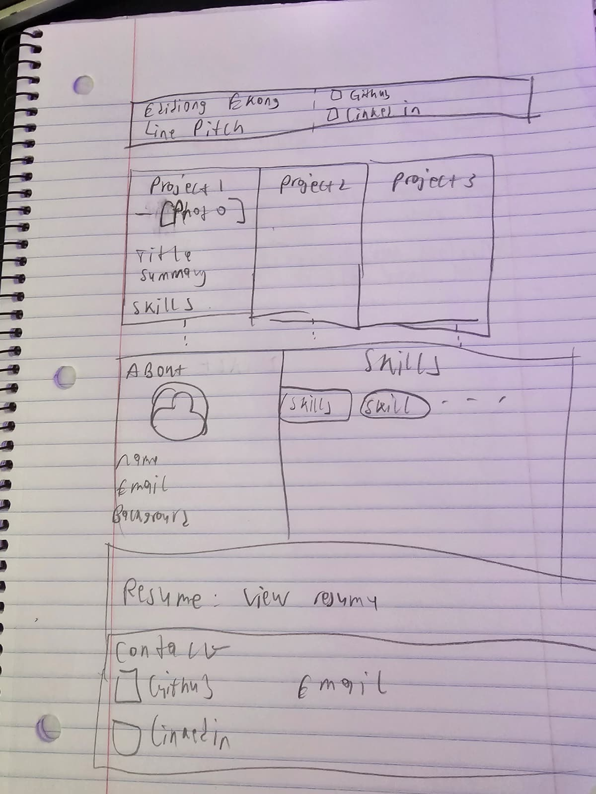

# Portfolio Design Notes

Working reference for the look of the site. 

---

## Principles

1. **Projects first.** The grid is the first thing below the header. No hero
   image, no large photo of me. The work carries the visuals.
2. **Automatic light/dark.** Follows the viewer's system setting
   (`prefers-color-scheme`). No manual toggle for v1.
3. **Quiet and technical.** It will have neutral backgrounds, one accent color, monospace
   for small labels. Let photos of boards and hardware stand out.
4. **Fast and simple.** Static site, no animations beyond hover states.

---

## Color

One palette per mode. Same roles in both so components only reference roles.

| Role        | Light       | Dark        | Used for                          |
|-------------|-------------|-------------|-----------------------------------|
| background  | `#FAFAF9`   | `#0F1115`   | Page background                   |
| surface     | `#FFFFFF`   | `#171A1F`   | Cards, project page panels        |
| text        | `#1C1E21`   | `#E8EAED`   | Headings, body                    |
| muted       | `#5F6670`   | `#9AA1AB`   | Summaries, dates, secondary text  |
| border      | `#E4E4E1`   | `#2A2F36`   | Card borders, dividers            |
| chip        | `#EEF0EF`   | `#1F242B`   | Tag chip background               |
| accent      | `#0E7C66`   | `#34D3A8`   | Links, hover, focus ring          |

Notes:
- Accent is a solder-mask-style green-teal. `TODO:` swap if you want another
  hue; keep the dark-mode version brighter than the light one.
- Avoid pure white `#FFF` as page background and pure black `#000` anywhere.
- Cards use a 1px border instead of shadows (shadows vanish in dark mode).
- `TODO:` check text/muted/accent contrast against background in both modes
  (aim for 4.5:1 or better) once it's on screen.

---

## Typography

| Use              | Font            | Notes                                |
|------------------|-----------------|--------------------------------------|
| Body + headings  | Inter           | Loaded via `next/font/google`        |
| Tags, labels     | JetBrains Mono  | Tag chips, dates, small meta text    |

Type scale (px, desktop):

| Token   | Size | Weight | Where                               |
|---------|------|--------|-------------------------------------|
| display | 40   | 700    | My name in the header               |
| h1      | 28   | 700    | Project page title                  |
| h2      | 20   | 600    | Section headings, card titles       |
| body    | 16   | 400    | Paragraphs, summaries               |
| small   | 14   | 400/500| Tags, meta, footer                  |

- On mobile, drop display to 32 and h1 to 24.
- Line height ~1.6 for body text, ~1.2 for headings.
- Body text max width ~70 characters on the project page.

---

## Spacing and shape

- Base unit: **8px**. Use 8 / 16 / 24 / 32 / 48 / 64.
- Space between page sections: 64px desktop, 48px mobile.
- Page content max width: **1100px**, centered, 16px side padding on mobile.
- Card corner radius: **12px**. Tag chips: fully rounded.
- Grid gap: 24px.

---

## Layout (one-page site, top to bottom)

1. **Header** — Name + one-line pitch:
   "Computer engineer: embedded, hardware, and full-stack."
   Slim, no image. small links to GitHub/LinkedIn here too
2. **Project grid** — directly under the header.
   - Desktop (≥1024px): 3 columns
   - Tablet (≥640px): 2 columns
   - Mobile: 1 column
3. **About + Skills** — side by side on desktop, stacked on mobile.
   small round photo of me here.
   Skills grouped: Embedded · Hardware · Software.
4. **Resume** — one clear button linking to `/EdidiongEkong_Resume.pdf`.
5. **Contact** — GitHub, LinkedIn, email. Simple row, footer style.

---

## Project card

```
┌─────────────────────────┐
│                         │
│      photo (4:3)        │
│                         │
├─────────────────────────┤
│ Title                   │
│ One-line summary        │
│ [C] [PCB] [RP2040]      │
└─────────────────────────┘
```

- Whole card is clickable (links to project page, or external link if no page yet).
- Hover: border changes to accent color, image scales very slightly.
- Max ~4 tags shown on the card; full list on the project page.
- Photos: cropped to 4:3, WebP, under ~300KB each.

---

## Project page

1. Cover photo (wide)
2. Title + tags + date
3. **Problem** — what needed solving and why
4. **My role** — what I personally did (team vs. solo)
5. **Tech** — tools, parts, languages, and why they were chosen
6. **Photos** — gallery with short captions
7. **Result** — what worked, numbers if available, what I'd do next
8. Back link to the grid

---

## Photography guidelines

- Plain, uncluttered background (desk mat, white paper, or dark cloth).
- Same crop ratio (4:3) for every card photo.
- Natural or even lighting, no harsh flash glare on boards.
- Shoot both "in action" (LEDs on, screen running) and close-up detail shots.

---

## Open decisions

- [ ] Final accent color - wnat to see it visually along other page items first
- [ ] Small photo of me in About: yes
- [ ] Contact links in header as well as footer
- [ ] Email shown as text or `mailto:` button only - both
- [ ] Custom domain later, or stay on `<username>.github.io`, stay on github

---

## References

https://www.tonybatts.com/#home
- It had everything in one page and a navbar that moved to different sections of the page. Also had cards that flipped to give more info on the project. (I like this. A project page probably works better though bu we will see)
- A lot of portfolios I see seem to have a big message saying Hi, their nae adn what they do, i think its some sort of template. dont know about having this yet.

Sketch:   